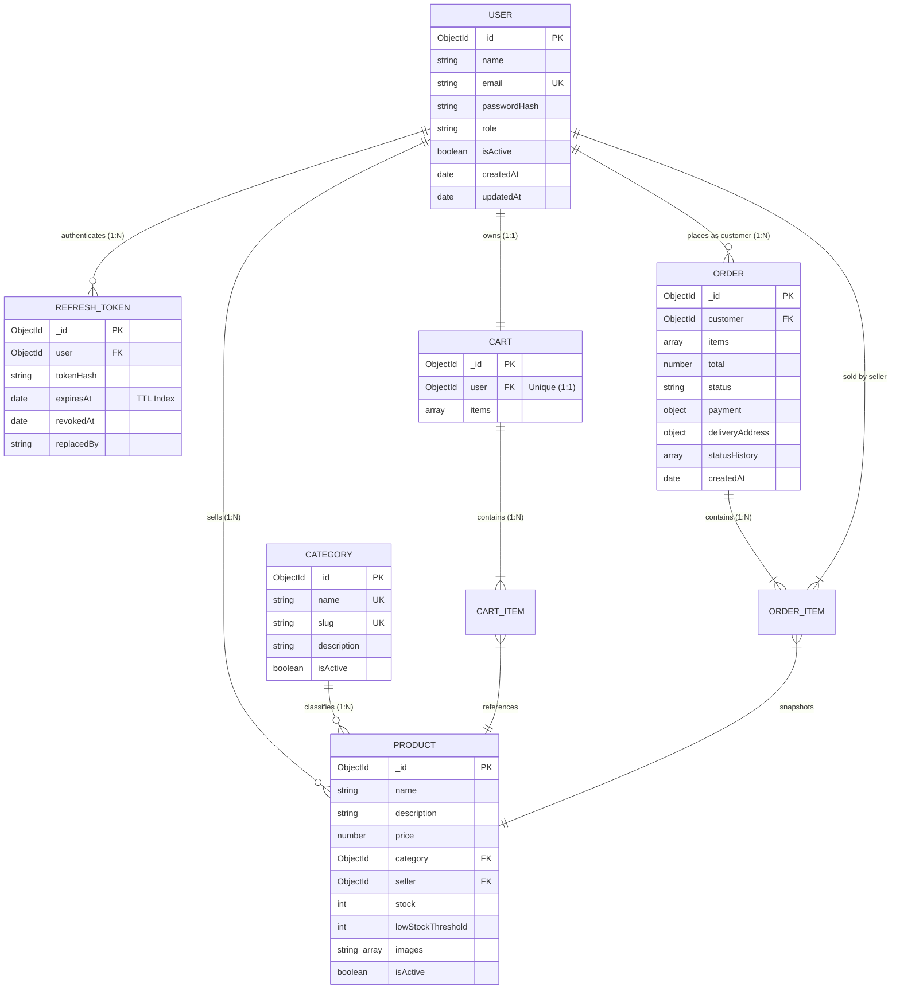

# Database Architecture, Schema Design & Indexing (DATABASE.md)

This document provides a comprehensive technical reference for the MongoDB database architecture, Mongoose schemas, entity relationships, index mappings, aggregation pipelines, and atomic transaction semantics.

---

## 1. Entity-Relationship Model (ERD)



### Entity Relationship Descriptions:
1. **User $\rightarrow$ Product (1:N):** A user with `role: "seller"` can create and manage multiple product catalog entries.
2. **User $\rightarrow$ Cart (1:1):** Every customer has exactly one shopping cart document enforced via a MongoDB unique index on the `user` field.
3. **Cart $\rightarrow$ CartItem (1:N):** A cart document embeds an array of line items referencing product IDs and quantities (capped at 50 distinct items).
4. **User $\rightarrow$ Order (1:N):** A customer can place multiple orders over time.
5. **Order $\rightarrow$ OrderItem (1:N):** An order embeds immutable line items capturing price snapshots, quantities, product references, and seller references.
6. **Category $\rightarrow$ Product (1:N):** Each product belongs to exactly one category.
7. **User $\rightarrow$ RefreshToken (1:N):** A user can have multiple active or rotated refresh tokens across different client devices/sessions.

---

## 2. Collections & Schema Data Dictionary

### 1. `users` Collection
- **Mongoose Model:** `src/models/User.js`
- **Fields:**
  - `name`: `String`, required, trimmed, min 2, max 50 chars.
  - `email`: `String`, required, unique, trimmed, lowercase, regex-validated.
  - `passwordHash`: `String`, required, `select: false` (omitted by default from queries to prevent accidental password hash leakage).
  - `role`: `String`, enum: `['customer', 'seller', 'admin']`, default: `'customer'`.
  - `isActive`: `Boolean`, default: `true` (administrative deactivation flag).
  - `timestamps`: `createdAt`, `updatedAt` (automatic ISO dates).

### 2. `refreshtokens` Collection
- **Mongoose Model:** `src/models/RefreshToken.js`
- **Fields:**
  - `user`: `ObjectId`, ref: `User`, required, indexed.
  - `tokenHash`: `String`, required, indexed (SHA-256 hash of the plaintext bearer refresh token). Each refresh token includes a unique jti (random UUID) so that two tokens issued in the same second never share a hash.
  - `expiresAt`: `Date`, required, configured with MongoDB TTL auto-cleanup index.
  - `revokedAt`: `Date`, default: `null` (timestamp when token was superseded).
  - `replacedBy`: `String`, default: `null` (SHA-256 hash of successor token for replay attack forensics).
  - `timestamps`: `createdAt`, `updatedAt`.

### 3. `categories` Collection
- **Mongoose Model:** `src/models/Category.js`
- **Fields:**
  - `name`: `String`, required, unique, trimmed, min 2, max 50 chars.
  - `slug`: `String`, required, unique, lowercase, trimmed (auto-generated URL slug).
  - `description`: `String`, default: `''`, max 500 chars.
  - `isActive`: `Boolean`, default: `true`.
  - `timestamps`: `createdAt`, `updatedAt`.

### 4. `products` Collection
- **Mongoose Model:** `src/models/Product.js`
- **Fields:**
  - `name`: `String`, required, trimmed, min 2, max 120 chars.
  - `description`: `String`, required, trimmed, min 5, max 2000 chars.
  - `price`: `Number`, required, min 0 (floating-point currency).
  - `category`: `ObjectId`, ref: `Category`, required, indexed.
  - `seller`: `ObjectId`, ref: `User`, required, indexed.
  - `stock`: `Number` (Integer), required, min 0.
  - `lowStockThreshold`: `Number` (Integer), default: 5, min 0.
  - `images`: Array of `String` URL references.
  - `isActive`: `Boolean`, default: `true` (soft-delete flag).
  - `timestamps`: `createdAt`, `updatedAt`.

### 5. `carts` Collection
- **Mongoose Model:** `src/models/Cart.js`
- **Design Rule:** Never stores unit prices, line totals, subtotals, or product names.
- **Fields:**
  - `user`: `ObjectId`, ref: `User`, required, **unique index**.
  - `items`: Array of subdocuments:
    - `product`: `ObjectId`, ref: `Product`, required.
    - `quantity`: `Number` (Integer), required, min 1, max 99.
  - `timestamps`: `createdAt`, `updatedAt`.

### 6. `orders` Collection
- **Mongoose Model:** `src/models/Order.js`
- **Fields:**
  - `customer`: `ObjectId`, ref: `User`, required, indexed.
  - `items`: Array of subdocuments:
    - `product`: `ObjectId`, ref: `Product`, required.
    - `seller`: `ObjectId`, ref: `User`, required.
    - `name`: `String`, required (historical name freeze).
    - `priceSnapshot`: `Number`, required, min 0 (historical financial snapshot).
    - `quantity`: `Number` (Integer), required, min 1.
  - `total`: `Number`, required, min 0.
  - `status`: `String`, enum: `['pending', 'confirmed', 'shipped', 'delivered', 'cancelled']`, default: `'pending'`.
  - `payment`: Subdocument:
    - `method`: `String`, default: `'SIMULATED'`.
    - `status`: `String`, default: `'COMPLETED'`.
    - `transactionId`: `String`, required.
  - `deliveryAddress`: Subdocument `{ street, city, state, postalCode, country }`.
  - `statusHistory`: Array of `{ status, by (User ref), at (Date), note }`.
  - `timestamps`: `createdAt`, `updatedAt`.

---

## 3. Comprehensive Database Index Specifications

Indexes are defined directly in `src/models/` to satisfy query filtering and sorting directly from B-Tree index memory without table scans (`COLLSCAN`) or in-memory sorts (`sort key generator`).

| Collection | Model File | Index Specification | Type | Query / Operation Served | Rationale & Performance Impact |
|---|---|---|---|---|---|
| `users` | `src/models/User.js` | `{ email: 1 }` | Unique B-Tree | `POST /auth/login`, `POST /auth/register` | O(1) email lookups during login; guarantees zero duplicate email registrations. |
| `users` | `src/models/User.js` | `{ role: 1 }` | Secondary B-Tree | `GET /users?role=seller` | Fast index scan when filtering users by role in administrative dashboards. |
| `users` | `src/models/User.js` | `{ isActive: 1 }` | Secondary B-Tree | User status checks & deactivation queries | High-speed filtering of active accounts across the platform. |
| `refreshtokens` | `src/models/RefreshToken.js` | `{ expiresAt: 1 }, { expireAfterSeconds: 0 }` | TTL Index | Automatic Token Eviction | MongoDB background cleanup thread deletes expired token documents automatically. Zero cron jobs needed. |
| `refreshtokens` | `src/models/RefreshToken.js` | `{ tokenHash: 1 }` | Secondary B-Tree | `POST /auth/refresh`, `POST /auth/logout` | High-speed O(1) lookup of incoming cryptographic token hashes during rotation. |
| `refreshtokens` | `src/models/RefreshToken.js` | `{ user: 1 }` | Secondary B-Tree | Replay Attack Token Invalidation | Instant mass revocation (`deleteMany({ user })`) when token reuse or password reset is triggered. |
| `categories` | `src/models/Category.js` | `{ name: 1 }` | Unique B-Tree | `POST /categories`, `PATCH /categories/:id` | Enforces unique human-readable category names. |
| `categories` | `src/models/Category.js` | `{ slug: 1 }` | Unique B-Tree | Slug generation uniqueness & internal lookup | Guarantees uniqueness for SEO URL slugs (public lookup endpoint uses `GET /categories/:id`). |
| `categories` | `src/models/Category.js` | `{ isActive: 1 }` | Secondary B-Tree | Public category filtering | Quickly excludes deactivated categories from public catalog navigation. |
| `products` | `src/models/Product.js` | `{ name: "text", description: "text" }` | Text Index (weights: name: 10, description: 5) | `GET /products?search=...` | Powers full-text search across titles and descriptions with text scoring (`$text: { $search: q }`). |
| `products` | `src/models/Product.js` | `{ category: 1, price: 1 }` | Compound B-Tree | `GET /products?category=X&sort=price` | Follows the **ESR (Equality, Sort, Range)** rule: category (Equality) filters the branch; price (Sort/Range) traverses in order without in-memory sorting. |
| `products` | `src/models/Product.js` | `{ seller: 1 }` | Secondary B-Tree | `GET /products/mine`, ownership check | Fast lookup of seller inventory and authorization verification during product updates/deletions. |
| `products` | `src/models/Product.js` | `{ isActive: 1 }` | Secondary B-Tree | `GET /products` (Public Catalog) | High-speed filtering of active inventory; excludes soft-deleted items. |
| `carts` | `src/models/Cart.js` | `{ user: 1 }, { unique: true }` | Unique B-Tree | `GET /cart`, `POST /cart/items` | Guarantees exactly one shopping cart per user; prevents race conditions during cart initialization. |
| `orders` | `src/models/Order.js` | `{ customer: 1 }` | Secondary B-Tree | `GET /orders` (Customer Lookups) | Single-field index on customer reference for fast order association lookups. |
| `orders` | `src/models/Order.js` | `{ status: 1 }` | Secondary B-Tree | `GET /orders?status=pending` | Administrative filtering by order lifecycle state. |
| `orders` | `src/models/Order.js` | `{ customer: 1, createdAt: -1 }` | Compound B-Tree | `GET /orders` (Customer History) | Fetches customer orders in descending chronological order directly from index. |
| `orders` | `src/models/Order.js` | `{ 'items.seller': 1, createdAt: -1 }` | Compound Multikey | `GET /orders` (Seller Dashboard) | Indexes multi-vendor line items, allowing sellers to retrieve their orders sorted by date. |

---

## 4. Multi-Stage MongoDB Aggregation Pipelines

All business intelligence metrics in `src/services/report.service.js` are computed natively on the MongoDB database engine.

### Pipeline 1: Daily Sales Revenue Summary (`getSalesReport`)
For Admins, aggregates across all non-cancelled platform orders; for Sellers, unwinds `items` and matches `items.seller`. The service returns an outer wrapper containing `summary` (total revenue, total orders, total items sold) and `dailyBreakdown`:

```javascript
// Admin Pipeline:
[
  // Stage 1: Filter non-cancelled orders within target date window
  {
    $match: {
      status: { $ne: 'cancelled' },
      ...(startDate || endDate ? { createdAt: { ...(startDate ? { $gte: startDate } : {}), ...(endDate ? { $lte: endDate } : {}) } } : {})
    }
  },
  // Stage 2: Group by date and calculate gross metrics
  {
    $group: {
      _id: { $dateToString: { format: '%Y-%m-%d', date: '$createdAt' } },
      revenue: { $sum: '$total' },
      ordersCount: { $sum: 1 },
      itemsSold: { $sum: { $sum: '$items.quantity' } }
    }
  },
  // Stage 3: Reshape output fields
  {
    $project: {
      date: '$_id',
      _id: 0,
      revenue: { $round: ['$revenue', 2] },
      ordersCount: 1,
      itemsSold: 1
    }
  },
  // Stage 4: Chronological sort
  { $sort: { date: 1 } }
]
// Output is wrapped by service layer: { summary: totals, dailyBreakdown }
```

### Pipeline 2: Velocity-Ranked Best Sellers (`getBestSellers`)
```javascript
[
  // Stage 1: Exclude cancelled orders
  { $match: { status: { $ne: 'cancelled' } } },
  // Stage 2: Deconstruct items array into individual documents
  { $unwind: '$items' },
  // Stage 3 (Conditional for Sellers): Filter by seller ID
  ...(isSeller ? [{ $match: { 'items.seller': sellerId } }] : []),
  // Stage 4: Aggregate units sold and gross revenue per product
  {
    $group: {
      _id: '$items.product',
      name: { $first: '$items.name' },
      totalUnitsSold: { $sum: '$items.quantity' },
      totalRevenue: {
        $sum: { $multiply: ['$items.priceSnapshot', '$items.quantity'] }
      }
    }
  },
  // Stage 5: Sort by units sold descending
  { $sort: { totalUnitsSold: -1 } },
  // Stage 6: Limit to top N products
  { $limit: limit },
  // Stage 7: Left outer join to enrich live stock and active status
  {
    $lookup: {
      from: 'products',
      localField: '_id',
      foreignField: '_id',
      as: 'productDoc'
    }
  },
  // Stage 8: Project clean representation
  {
    $project: {
      productId: '$_id',
      _id: 0,
      name: 1,
      totalUnitsSold: 1,
      totalRevenue: { $round: ['$totalRevenue', 2] },
      currentStock: { $ifNull: [{ $arrayElemAt: ['$productDoc.stock', 0] }, 0] },
      isActive: { $ifNull: [{ $arrayElemAt: ['$productDoc.isActive', 0] }, false] }
    }
  }
]
```

### Pipeline 3: Category Inventory Valuation (`getInventorySummary`)
```javascript
[
  // Stage 1: Include active catalog items only
  { $match: { isActive: true, ...(isSeller ? { seller: sellerId } : {}) } },
  // Stage 2: Group by category and compute asset metrics
  {
    $group: {
      _id: '$category',
      totalProducts: { $sum: 1 },
      totalStock: { $sum: '$stock' },
      totalStockValue: { $sum: { $multiply: ['$price', '$stock'] } },
      lowStockProductsCount: {
        $sum: { $cond: [{ $lte: ['$stock', '$lowStockThreshold'] }, 1, 0] }
      }
    }
  },
  // Stage 3: Join category metadata
  {
    $lookup: {
      from: 'categories',
      localField: '_id',
      foreignField: '_id',
      as: 'categoryDoc'
    }
  },
  // Stage 4: Format output
  {
    $project: {
      categoryId: '$_id',
      _id: 0,
      categoryName: {
        $ifNull: [{ $arrayElemAt: ['$categoryDoc.name', 0] }, 'Uncategorized']
      },
      totalProducts: 1,
      totalStock: 1,
      totalStockValue: { $round: ['$totalStockValue', 2] },
      lowStockProductsCount: 1
    }
  },
  // Stage 5: Sort by highest inventory capital first
  { $sort: { totalStockValue: -1 } }
]
```

---

## 5. Seed Data Architecture & Initial Entities

Running `npm run seed` (`src/seed/seed.js`) populates a deterministic baseline dataset:

1. **System Users (5 Accounts):**
   - 1 Admin: `admin@example.com` (`AdminPass123!`)
   - 2 Sellers: `seller@example.com` (Seller A), `seller2@example.com` (Seller B) (`SellerPass123!`)
   - 2 Customers: `customer@example.com` (Active), `inactive@example.com` (`isActive: false`) (`CustomerPass123!`)
2. **5 Categories (`categoriesToSeed` in `src/seed/seed.js`):**
   - Electronics (`electronics`) - Smartphones, laptops, accessories, and smart devices.
   - Clothing & Apparel (`clothing-apparel`) - Fashionable outfits, footwear, and designer clothing.
   - Home & Kitchen (`home-kitchen`) - Furniture, cookware, smart home appliances, and decor.
   - Books & Media (`books-media`) - Bestselling novels, educational books, and digital media.
   - Sports & Fitness (`sports-fitness`) - Workout gear, outdoor equipment, and fitness accessories.
3. **17 Products (`productsToSeed` in `src/seed/seed.js`):**
   - **Electronics (5 items):**
     1. *Pro Wireless Noise Cancelling Headphones* (Seller A, Price: $199.99, Stock: 50, LowStockThreshold: 5)
     2. *Ultra-Slim Mechanical Gaming Keyboard* (Seller A, Price: $89.99, Stock: 25, LowStockThreshold: 5)
     3. *4K Ultra-HD Action Camera* (Seller B, Price: $149.50, Stock: 30, LowStockThreshold: 5)
     4. *Flagship OLED 120Hz Smartphone* (Seller B, Price: $899.00, Stock: 3, LowStockThreshold: 5) - **Low Stock Alert**
     5. *Ergonomic Vertical Wireless Mouse* (Seller A, Price: $39.99, Stock: 0, LowStockThreshold: 5) - **Out of Stock**
   - **Clothing & Apparel (3 items):**
     6. *Classic Vintage Denim Jacket* (Seller A, Price: $69.99, Stock: 40, LowStockThreshold: 5)
     7. *Breathable Merino Wool Athletic Hoodie* (Seller B, Price: $85.00, Stock: 18, LowStockThreshold: 5)
     8. *Minimalist Leather Oxford Shoes* (Seller A, Price: $130.00, Stock: 15, LowStockThreshold: 5)
   - **Home & Kitchen (3 items):**
     9. *Precision Electric Coffee Burr Grinder* (Seller B, Price: $119.00, Stock: 22, LowStockThreshold: 5)
     10. *Pre-Seasoned Cast Iron Skillet 12-inch* (Seller A, Price: $34.95, Stock: 35, LowStockThreshold: 5)
     11. *Smart Air Purifier with HEPA Filter* (Seller B, Price: $159.99, Stock: 12, LowStockThreshold: 5)
   - **Books & Media (3 items):**
     12. *Designing Data-Intensive Applications* (Seller A, Price: $44.99, Stock: 45, LowStockThreshold: 5)
     13. *Clean Code: A Handbook of Agile Software Craftsmanship* (Seller A, Price: $38.50, Stock: 30, LowStockThreshold: 5)
     14. *The Pragmatic Programmer: 20th Anniversary Edition* (Seller B, Price: $42.00, Stock: 20, LowStockThreshold: 5)
   - **Sports & Fitness (3 items):**
     15. *Adjustable Quick-Select Dumbbell Set* (Seller B, Price: $299.99, Stock: 8, LowStockThreshold: 5)
     16. *Non-Slip Eco-Friendly Natural Rubber Yoga Mat* (Seller A, Price: $49.99, Stock: 60, LowStockThreshold: 5)
     17. *Insulated Stainless Steel Water Bottle 32oz* (Seller A, Price: $24.99, Stock: 75, LowStockThreshold: 5)

---

## 6. ACID Transactions & Concurrency Control

### Multi-Document Transactions (`session.withTransaction`) (Simplified Excerpt from `src/services/order.service.js`)
All state changes during checkout (`POST /orders`) and order cancellation (`POST /orders/:id/cancel`) execute within a Mongoose session:

```javascript
const session = await mongoose.startSession();
try {
  await session.withTransaction(async () => {
    // 1. Conditional Atomic Stock Decrement
    for (const item of cart.items) {
      const updateResult = await Product.updateOne(
        { _id: item.product._id, stock: { $gte: item.quantity }, isActive: true },
        { $inc: { stock: -item.quantity } },
        { session }
      );

      // If modifiedCount is 0, stock was insufficient or product was deactivated
      if (updateResult.modifiedCount === 0) {
        throw ApiError.conflict(`Insufficient stock for product '${item.product.name}'.`);
      }
    }

    // 2. Persist Order with Frozen Prices
    createdOrder = await Order.create([orderPayload], { session });

    // 3. Clear Shopping Cart
    await Cart.updateOne({ user: userId }, { items: [] }, { session });
  });
} finally {
  await session.endSession();
}
```

### Prevention of Race Conditions:
- **No In-Memory Checks:** The application **never** performs `if (product.stock >= quantity) product.stock -= quantity; product.save()`. In-memory checks allow multiple concurrent Node.js async operations to read the same stock value and oversell.
- **Pushing Condition to Storage Engine:** By passing `{ stock: { $gte: item.quantity } }` directly to `Product.updateOne`, MongoDB acquires a document-level write lock. Writes are serialized. The first transaction succeeds and decrements stock. The second concurrent transaction evaluates `{ stock: { $gte: item.quantity } }`, fails to find a match (`modifiedCount === 0`), and automatically triggers an instant transaction abort and HTTP 409 Conflict.
