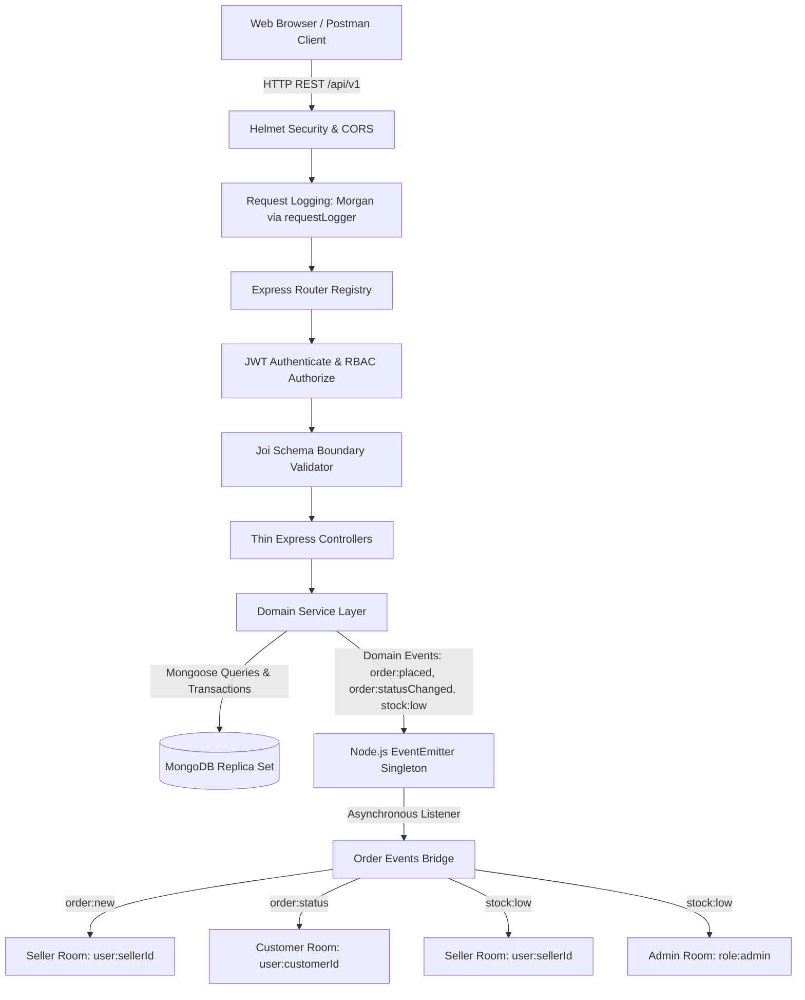
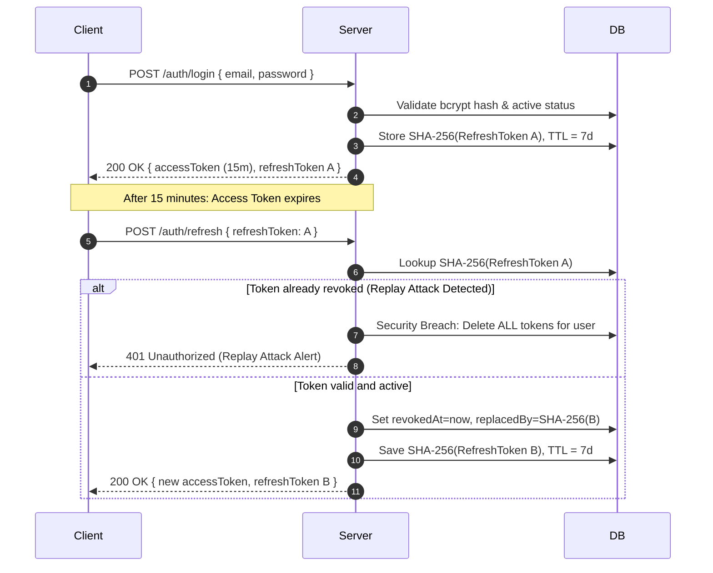
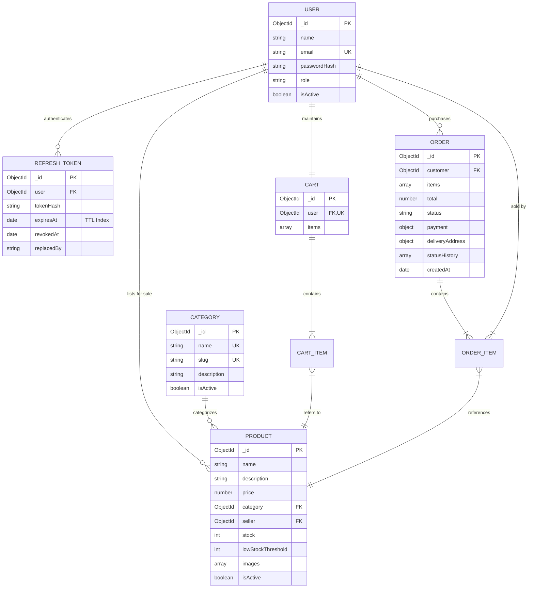
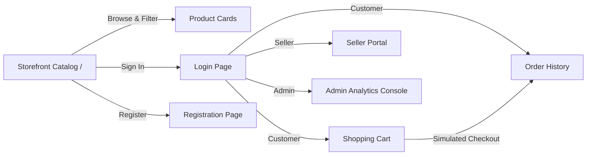

# ACADEMIC CAPSTONE PROJECT REPORT

---

# E-Commerce & Real-Time Inventory Management System

### **A Scalable Full-Stack Web Application with ACID Concurrency Control, Event-Driven WebSocket Telemetry, and Native Aggregation Analytics**

---

### **Project Metadata:**
- **Course / Degree:** [B.Tech CSE AI & ML]
- **Student Name:** [Dhruv Sehrawat]
- **Roll Number / PRN:** [2501730048]
- **Department:** Department of Computer Science & Engineering
- **Institution:** [K.R Mangalam University]
- **Date of Submission:** November 2026

---

## Abstract

In modern e-commerce systems, concurrent multi-user checkouts and high-velocity catalog mutations present severe data integrity risks, including overselling, race conditions, stale inventory reads, and financial discrepancies from client-side tampering. This capstone project designs, architects, and implements a full-stack e-commerce and real-time inventory management platform engineered with **Node.js, Express.js, MongoDB (Mongoose), Socket.IO, and native Node.js EventEmitter**, coupled with an editorial retail storefront built with vanilla HTML5, CSS3, and ES Modules.

The backend adopts a decoupled MVC with a service layer architectural pattern with strict boundary validation (Joi), centralized operational error trapping (`ApiError`), and uniform response envelopes (`ApiResponse`). Security is enforced through an ephemeral JSON Web Token (JWT) access model combined with sliding-window, cryptographically hashed refresh token rotation stored in MongoDB with automatic TTL eviction and replay attack detection.

Concurrency control during checkout is resolved without distributed deadlocks through MongoDB Multi-Document ACID Transactions combined with atomic conditional decrements (`{ stock: { $gte: quantity } }`). A decoupled asynchronous event pipeline bridges database writes to WebSocket broadcasts, delivering live order and low-stock telemetry to administrative and vendor dashboards. Furthermore, multi-stage MongoDB aggregation pipelines power real-time analytics for gross revenue trends, velocity-ranked product sales, and category-level inventory valuations. The system is designed to prevent overselling, maintain transactional data consistency, and enforce defense-in-depth security under structured automated verification.

---

## Chapter 1: Introduction

### 1.1 Problem Statement
Traditional web-based retail applications frequently suffer from architectural deficiencies that manifest as critical business failures under concurrent user loads:
1. **Overselling and Inventory Inconsistencies:** The common "read-modify-write" anti-pattern (`const product = await Product.findById(); if (product.stock >= qty) product.stock -= qty; await product.save()`) creates an acute race condition. When multiple shoppers attempt to checkout the last item concurrently, multiple asynchronous threads read identical stock counts before writing, driving inventory into negative numbers and generating unfulfillable orders.
2. **Client-Side Price Tampering & Stale Carts:** Many platforms persist line-item prices or calculated totals inside client-side local storage or shopping cart database records. Malicious actors intercept HTTP requests to inject reduced prices, or shoppers leave items in carts for weeks, checking out at outdated prices after vendor catalog adjustments.
3. **Authentication Vulnerabilities:** Long-lived static tokens or unhashed database tokens expose users to session hijacking. Furthermore, naive refresh token systems lack the capability to detect token theft or replay attacks.
4. **Transport Layer Coupling:** Directly binding WebSocket broadcasts, transactional emails, and logging within HTTP controller handlers introduces high latency, violates the Single Responsibility Principle, and prevents independent automated testing.
5. **Slow Analytical Reporting:** Naive client-side array processing (`Array.reduce`, `Array.filter`) or repeated database round-trips for analytical metrics create severe database I/O bottlenecks.

### 1.2 Motivation
The modern digital economy demands software architectures that are resilient, strictly consistent, and observable in real time. Building a solution that combines relational-grade transactional guarantees with document-oriented schema flexibility provides profound insights into modern distributed systems, concurrency engineering, cryptographic session management, and reactive web development.

### 1.3 Project Objectives
The core engineering objectives of this project are:
- **Architectural Modularity:** Implement a strictly layered MVC with a service layer architecture separating HTTP transport from business logic.
- **Strict Role-Based Access Control (RBAC):** Provide granular authentication and authorization across three distinct system actors: `customer`, `seller`, and `admin`.
- **Overselling Prevention:** Use atomic conditional stock decrements inside MongoDB transactions so stock cannot go negative.
- **Zero Price Staling / Tampering:** Dynamically compute cart financial totals on the server from live product records while strictly forbidding client-submitted financial figures.
- **Decoupled Real-Time Telemetry:** Bridge domain events to WebSocket clients using an internal Node.js `EventEmitter` pattern, maintaining zero coupling between services and WebSockets.
- **High-Performance Aggregations:** Deliver deep business intelligence via native multi-stage MongoDB aggregation pipelines.
- **Handcrafted Editorial Frontend:** Provide a responsive, accessible user interface using modern vanilla JavaScript (ES Modules) without framework overhead.

### 1.4 Scope and Limitations
- **Functional Scope:** Complete REST API covering Authentication, User Profiles, Category Hierarchies, Product Catalog, Shopping Cart, ACID Checkout, Order Lifecycle Tracking, and Analytics.
- **Real-Time Scope:** Targeted WebSocket rooms partitioned by user ID (`user:<id>`) and administrative role (`role:admin`).
- **Simulated Payment Sandbox:** In accordance with academic capstone constraints, payment processing uses a simulated internal provider (`SIMULATED`) that records a COMPLETED status and a generated transaction reference, without live third-party banking gateway dependencies.
- **Media Upload Strategy:** Product imagery is handled via verified URL strings rather than binary multipart S3 uploads.
- **Clustering Scope:** Single-node Socket.IO architecture; horizontal scaling across multiple server instances would necessitate an external Redis Pub/Sub adapter.

---

## Chapter 2: System Requirements & Specification

### 2.1 Functional Requirements by Module

#### Module A: Authentication & User Administration
- **FR-A1 (Registration):** Public self-registration for `customer` and `seller` roles. Registering with `role: "admin"` is strictly rejected.
- **FR-A2 (Login):** Authenticates via email and password with bcrypt hash verification (12 salt rounds). Returns short-lived access token (15m) and rotating refresh token (7d).
- **FR-A3 (Token Rotation & Replay Detection):** Every `/auth/refresh` invocation revokes the submitted refresh token and issues a new pair. If a revoked token is presented, all active sessions for that user are immediately invalidated.
- **FR-A4 (User Management):** Administrators can view paginated user lists and activate/deactivate accounts. Account deactivation instantly revokes all associated refresh tokens.

#### Module B: Category Hierarchy
- **FR-B1 (Public Browsing):** Public retrieval of active category listings.
- **FR-B2 (Administrative Management):** Administrators can create, update, and delete categories. Category names automatically generate unique URL slugs.
- **FR-B3 (Referential Integrity):** Deleting a category that contains active or historical products is rejected with HTTP 409 Conflict.

#### Module C: Product Catalog & Search
- **FR-C1 (Public Search & Filters):** Full-text search across titles and descriptions, category filtering, price range boundaries, in-stock filtering, and whitelisted sorting.
- **FR-C2 (Seller Inventory Management):** Sellers manage their own catalog items (`/products/mine`). Cross-tenant modifications by unauthorized sellers are rejected with HTTP 403 Forbidden.
- **FR-C3 (Soft Deletion):** Deleting products sets `isActive: false` to preserve referential integrity for existing orders and analytics.

#### Module D: Shopping Cart
- **FR-D1 (Tenant Isolation):** Shopping carts are looked up strictly by the authenticated customer's token (`req.user._id`); no client-supplied cart IDs are permitted.
- **FR-D2 (Dynamic Server Totals):** Cart documents store only `{ product, quantity }`. All unit prices, line totals, and subtotals are computed dynamically from live product catalog records.
- **FR-D3 (Tampering Rejection):** Client payloads attempting to supply `price`, `total`, or `subtotal` are rejected with HTTP 400 Bad Request.
- **FR-D4 (Non-Destructive Issue Flagging):** Unavailable or low-stock items are flagged (`PRODUCT_UNAVAILABLE`, `INSUFFICIENT_STOCK`) without destroying the customer's cart state.

#### Module E: Orders & State Machine
- **FR-E1 (ACID Checkout):** Validates cart items, verifies inventory, opens a MongoDB transaction, atomically decrements stock, persists the order with historical price snapshots, and clears the cart.
- **FR-E2 (Finite State Machine):** Enforces strict lifecycle progression: `pending -> confirmed -> shipped -> delivered`. Disallows backward or terminal state transitions.
- **FR-E3 (Cancellation & Restock):** Customers and vendors can cancel orders in `pending` or `confirmed` status. Cancellation atomically restores product inventory inside a transaction.

#### Module F: Real-Time Telemetry & Business Intelligence
- **FR-F1 (Live WebSocket Alerts):** Dispatches instant notifications on new orders (`order:new`), status changes (`order:status`), and inventory warnings (`stock:low`).
- **FR-F2 (Analytical Reports):** Three server-side aggregation pipelines: Daily Sales Trends, Velocity-Ranked Best Sellers, and Category Inventory Valuation.

### 2.2 Non-Functional Requirements (NFR)
- **NFR1 - Security:** Passwords hashed with bcrypt (12 rounds). Refresh tokens stored as one-way SHA-256 hashes. Rate limiting applied to authentication (10 attempts/15 min). Helmet security headers and CORS whitelisting configured.
- **NFR2 - Concurrency & Consistency:** Designed to prevent overselling under simultaneous checkouts using conditional atomic updates inside transactions. A concurrency test has not yet been run.
- **NFR3 - Maintainability & Modularity:** native ES Modules, declarative Joi perimeter validation, unified `ApiResponse` / `ApiError` structures, and centralized error handling via `asyncHandler`.
- **NFR4 - Performance:** Whitelisted indexing on all query paths, compound ESR indexes, text indexes, and automatic TTL expiration.

---

## Chapter 3: System Architecture & Design

### 3.1 Layered Architecture Overview
The platform employs a layered, separation-of-concerns pattern:



### 3.2 Component Interaction Lifecycle
1. **Incoming Request:** Handled by global security middleware (Helmet, CORS) and request logging (Morgan via requestLogger).
2. **Routing & Authentication:** Matched against route definitions in `src/routes/`. The `authenticate` middleware verifies the JWT bearer token, checks account active status in the database, and injects `req.user`.
3. **Authorization & Validation:** The `authorize` middleware checks if `req.user.role` matches allowed roles. The `validate` middleware verifies body, query, or params against strict Joi schemas.
4. **Controller Execution:** Unpacks validated input and delegates directly to the Service layer. Wrapped in `asyncHandler` to route exceptions to centralized error middleware.
5. **Service Layer:** Executes domain rules, starts Mongoose sessions, coordinates transactions, and queries models.
6. **Event Dispatch:** Dispatches decoupled domain events into the `EventEmitter` singleton.
7. **WebSocket Push:** Event handlers listen to domain events and emit Socket.IO packets to authenticated rooms.

### 3.3 Authentication & Security Architecture Design

#### 1. Dual-Token JWT Model with Replay Detection


#### 2. Role-Based Access Control (RBAC) Matrix

| Resource & Action | Method | Route | Public | Customer | Seller | Admin | Guard Mechanism |
|---|---|---|:---:|:---:|:---:|:---:|---|
| **Register** | POST | `/auth/register` | Yes | - | - | - | Public; rejects `role:admin` |
| **Login** | POST | `/auth/login` | Yes | - | - | - | Rate-limited (10 per 15 min) |
| **Profile** | GET | `/users/me` | No | Yes | Yes | Yes | `authenticate` |
| **User Management** | GET/PATCH | `/users/*` | No | No | No | Yes | `authorize('admin')` |
| **Categories CRUD** | POST/PATCH/DELETE | `/categories/*` | No | No | No | Yes | `authorize('admin')` |
| **Product Create** | POST | `/products` | No | No | Yes | Yes | `authorize('seller', 'admin')` |
| **Product Update** | PATCH/DELETE | `/products/:id` | No | No | Own | Yes | Ownership verification |
| **Shopping Cart** | ALL | `/cart/*` | No | Yes | No | No | `authorize('customer')` |
| **Checkout** | POST | `/orders` | No | Yes | No | No | `authorize('customer')` |
| **Order Progress** | PATCH | `/orders/:id/status` | No | No | Own | Yes | Ownership + FSM validation |
| **Order Cancel** | POST | `/orders/:id/cancel` | No | Own | Own | Yes | Ownership + FSM validation |
| **Analytics Reports** | GET | `/reports/*` | No | No | Scoped | Full | `authorize('seller', 'admin')` |

---

## Chapter 4: Database Design

### 4.1 Entity-Relationship Model (Mermaid ERD)



### 4.2 Schema Data Dictionary

#### 1. `users` Collection
- `name`: String, required, trimmed, min 2, max 50 chars.
- `email`: String, required, unique, lowercase, trimmed, indexed.
- `passwordHash`: String, required, `select: false` (excluded from standard queries).
- `role`: String, enum: `['customer', 'seller', 'admin']`, default: `'customer'`.
- `isActive`: Boolean, default: `true` (soft deactivation).
- `timestamps`: `createdAt`, `updatedAt`.

#### 2. `refreshtokens` Collection
- `user`: ObjectId $\rightarrow$ `User`, required, indexed.
- `tokenHash`: String, SHA-256 hash, indexed.
- `expiresAt`: Date, required, configured with MongoDB TTL auto-cleanup index.
- `revokedAt`: Date, default `null`.
- `replacedBy`: String, default `null` (successor hash for replay detection).

#### 3. `categories` Collection
- `name`: String, required, unique, trimmed, min 2, max 50 chars.
- `slug`: String, required, unique, lowercase, trimmed (auto-generated kebab slug).
- `description`: String, default `''`.
- `isActive`: Boolean, default `true`.

#### 4. `products` Collection
- `name`: String, required, trimmed, min 2, max 120 chars.
- `description`: String, required, trimmed, min 5, max 2000 chars.
- `price`: Number, required, min 0.
- `category`: ObjectId $\rightarrow$ `Category`, required, indexed.
- `seller`: ObjectId $\rightarrow$ `User`, required, indexed.
- `stock`: Integer, required, min 0.
- `lowStockThreshold`: Integer, default 5, min 0.
- `images`: Array of URI strings.
- `isActive`: Boolean, default: `true` (soft delete flag).

#### 5. `carts` Collection
- `user`: ObjectId $\rightarrow$ `User`, required, **unique index** (guarantees 1:1 relation).
- `items`: Array of subdocuments: `{ product: ObjectId, quantity: Integer (1-99) }`.
- *Architecture Rule: Stores no unit prices, line totals, or product names.*

#### 6. `orders` Collection
- `customer`: ObjectId $\rightarrow$ `User`, required, indexed.
- `items`: Array of subdocuments: `{ product: ObjectId, seller: ObjectId, name: String, priceSnapshot: Number, quantity: Integer }`.
- `total`: Number, required, min 0.
- `status`: String, enum: `['pending', 'confirmed', 'shipped', 'delivered', 'cancelled']`.
- `payment`: `{ method: 'SIMULATED', status: 'COMPLETED', transactionId: String }`.
- `deliveryAddress`: `{ street, city, state, postalCode, country }`.
- `statusHistory`: Array of `{ status, by: ObjectId, at: Date, note: String }`.

### 4.3 Database Indexing Strategy & Query Optimization

| Collection | Index Specification | Type | Query / Feature Optimized |
|---|---|---|---|
| `users` | `{ email: 1 }` | Unique B-Tree | High-speed credential lookup during login; prevents duplicate email signups. |
| `refreshtokens` | `{ expiresAt: 1 }, { expireAfterSeconds: 0 }` | TTL Index | Background MongoDB worker automatically purges expired tokens without manual cron jobs. |
| `refreshtokens` | `{ tokenHash: 1 }` | Secondary B-Tree | Instant O(1) hash matching during token rotation (`POST /auth/refresh`). |
| `products` | `{ name: "text", description: "text" }` | Text Index | Enables fast text search with stemming and scoring across titles and descriptions. |
| `products` | `{ category: 1, price: 1 }` | Compound B-Tree | Satisfies the **ESR Rule**: category (Equality) narrows branch; price (Sort) returns ordered data without in-memory sorting. |
| `products` | `{ seller: 1 }` | Secondary B-Tree | Accelerates seller inventory dashboard (`GET /products/mine`) and authorization checks. |
| `carts` | `{ user: 1 }, { unique: true }` | Unique B-Tree | Enforces single cart per customer; prevents duplicate cart documents under race conditions. |
| `orders` | `{ customer: 1, createdAt: -1 }` | Compound B-Tree | Fast retrieval of user order history sorted chronologically descending. |
| `orders` | `{ "items.seller": 1, createdAt: -1 }` | Multikey Compound | Accelerates seller dashboard order queries across multi-vendor line items. |

---

## Chapter 5: REST API Design

### 5.1 Design Principles & URL Conventions
- **Uniform Prefix:** All REST endpoints are exposed under `/api/v1`.
- **Stateless HTTP:** Each request carries authentication state via `Authorization: Bearer <accessToken>`.
- **Standardized Envelopes:** Every response adheres strictly to predictable success (`{ success: true, message, data }`) or error envelopes (`{ success: false, message, errors?, stack? }`). The HTTP status code is communicated exclusively in the HTTP response status line, not duplicated inside the JSON response body.

### 5.2 API Endpoint Catalog

| Module | Method | Path | Auth Required | Roles | Description |
|---|---|---|:---:|---|---|
| **Health** | GET | `/health` | No | Public | Returns uptime and database connection status (503 if down). |
| **Auth** | POST | `/auth/register` | No | Public | User self-registration (Customer or Seller). |
| **Auth** | POST | `/auth/login` | No | Public | Login with rate limiting; returns tokens. |
| **Auth** | POST | `/auth/refresh` | No | Public | Refresh token rotation with replay detection. |
| **Auth** | POST | `/auth/logout` | No | Public | Revokes refresh token in database. |
| **Users** | GET | `/users/me` | Yes | All | Returns authenticated user profile. |
| **Users** | PATCH | `/users/me` | Yes | All | Updates name and password (revoking tokens if password changed). |
| **Users** | GET | `/users` | Yes | Admin | Paginated list of users with role and status filters. |
| **Users** | PATCH | `/users/:id/status`| Yes | Admin | Deactivates user and invalidates all their active tokens. |
| **Categories**| GET | `/categories` | No | Public | List all active categories. |
| **Categories**| GET | `/categories/:id` | No | Public | Get single category details. |
| **Categories**| POST | `/categories` | Yes | Admin | Create category with auto-generated slug. |
| **Categories**| PATCH | `/categories/:id` | Yes | Admin | Update category details. |
| **Categories**| DELETE| `/categories/:id` | Yes | Admin | Delete category (blocked with 409 if products exist). |
| **Products** | GET | `/products` | No | Public | Public catalog search, category/price filters, and pagination. |
| **Products** | GET | `/products/mine` | Yes | Seller | List seller's own products (including soft-deleted). |
| **Products** | GET | `/products/:id` | No | Public | Get populated product details. |
| **Products** | POST | `/products` | Yes | Seller, Admin | Create product (seller forced to `req.user._id`). |
| **Products** | PATCH | `/products/:id` | Yes | Owner, Admin | Update product details (403 for unauthorized sellers). |
| **Products** | DELETE| `/products/:id` | Yes | Owner, Admin | Soft-delete product (`isActive: false`). |
| **Cart** | GET | `/cart` | Yes | Customer | View cart with server-computed line totals and stock issues. |
| **Cart** | POST | `/cart/items` | Yes | Customer | Add item to cart with stock validation (rejects client prices). |
| **Cart** | PATCH | `/cart/items/:id`| Yes | Customer | Update quantity (1-99). |
| **Cart** | DELETE| `/cart/items/:id`| Yes | Customer | Remove specific line item. |
| **Cart** | DELETE| `/cart` | Yes | Customer | Clear all items from cart. |
| **Orders** | POST | `/orders` | Yes | Customer | Multi-document ACID checkout with atomic stock decrement. |
| **Orders** | GET | `/orders` | Yes | All | Paginated orders (Customer: own; Seller: own items; Admin: all). |
| **Orders** | GET | `/orders/:id` | Yes | Owner, Seller, Admin | Get populated order details. |
| **Orders** | PATCH | `/orders/:id/status`| Yes | Seller, Admin | Progress order status via Finite State Machine. |
| **Orders** | POST | `/orders/:id/cancel`| Yes | Owner, Seller, Admin | Cancel order and atomically restore product stock. |
| **Reports** | GET | `/reports/sales` | Yes | Seller, Admin | Aggregation: Daily revenue and order count. |
| **Reports** | GET | `/reports/best-sellers`| Yes | Seller, Admin | Aggregation: Top-selling products ranked by velocity. |
| **Reports** | GET | `/reports/inventory` | Yes | Seller, Admin | Aggregation: Category stock count and valuation. |

---

## Chapter 6: Implementation Details

### 6.1 Atomic Concurrency-Safe Checkout & Stock Decrement (Simplified Excerpt)
The critical checkout algorithm prevents overselling and partial updates under concurrent transactions through MongoDB's multi-document ACID session combined with an atomic conditional filter:

```javascript
// Excerpt from src/services/order.service.js
const session = await mongoose.startSession();
try {
  await session.withTransaction(async () => {
    // 1. Re-validate cart within session
    const cart = await Cart.findOne({ user: customerId }).populate('items.product').session(session);
    if (!cart || cart.items.length === 0) throw ApiError.badRequest('Cart is empty.');

    // 2. Decrement stock atomically per item
    for (const item of cart.items) {
      const updateResult = await Product.updateOne(
        { _id: item.product._id, stock: { $gte: item.quantity }, isActive: true },
        { $inc: { stock: -item.quantity } },
        { session }
      );

      // If modifiedCount is 0, stock was insufficient or product was deactivated
      if (updateResult.modifiedCount === 0) {
        throw ApiError.conflict(`Product "${item.product.name}" has insufficient stock.`);
      }
    }

    // 3. Create order snapshot with SIMULATED payment
    const [createdOrder] = await Order.create([orderPayload], { session });

    // 4. Clear shopping cart atomically
    await Cart.updateOne({ user: customerId }, { $set: { items: [] } }, { session });
  });
} finally {
  await session.endSession();
}
```

### 6.2 Refresh Token Rotation with Replay Attack Detection (Simplified Excerpt)
Each refresh token includes a unique jti (random UUID) so that two tokens issued in the same second never share a hash.

```javascript
// Excerpt from src/services/auth.service.js
const tokenHash = crypto.createHash('sha256').update(incomingRefreshToken).digest('hex');
const tokenRecord = await RefreshToken.findOne({ tokenHash });

if (!tokenRecord) throw ApiError.unauthorized('Invalid refresh token.');

// Replay Attack Detection: If token is already revoked, wipe all user sessions!
if (tokenRecord.revokedAt) {
  await RefreshToken.deleteMany({ user: tokenRecord.user });
  throw ApiError.unauthorized('Replay attack detected. All sessions have been terminated.');
}

// Rotate: Revoke old token and issue fresh pair
tokenRecord.revokedAt = new Date();
const newAccessToken = generateAccessToken(user);
const newRefreshToken = generateRefreshToken(user);
tokenRecord.replacedBy = crypto.createHash('sha256').update(newRefreshToken).digest('hex');
await tokenRecord.save();
await saveRefreshToken(user._id, newRefreshToken);
```

### 6.3 Decoupled Real-Time Notification Pipeline (Simplified Excerpt)
```javascript
// 1. Service Layer emits domain event (agnostic of WebSockets)
eventEmitter.emit('order:placed', createdOrder);

// 2. Event Handler bridges to Socket.IO (src/events/orderEvents.js)
eventEmitter.on('order:placed', (order) => {
  // Extract distinct sellers who have items in this order
  const sellerIds = [...new Set(order.items.map((item) => item.seller.toString()))];

  // Push targeted notification to each seller's private room
  for (const sellerId of sellerIds) {
    emitOrderNew(sellerId, {
      orderId: order._id,
      status: order.status,
      message: 'You have received a new customer order!',
      total: order.total,
      itemsCount: order.items.filter((i) => i.seller.toString() === sellerId).length,
    });
  }
});
```

### 6.4 Dynamic Cart Price Calculation (Simplified Excerpt)
```javascript
// Excerpt from src/services/cart.service.js
// Totals are computed live from product records; prices are never read from the cart!
const computedItems = cart.items.map((item) => {
  const product = item.product;
  const isAvailable = product && product.isActive;
  const hasStock = isAvailable && product.stock >= item.quantity;
  const unitPrice = isAvailable ? product.price : 0;
  const lineTotal = hasStock ? unitPrice * item.quantity : 0;

  return {
    product: { _id: product._id, name: product.name, price: unitPrice },
    quantity: item.quantity,
    lineTotal,
    available: hasStock,
    issue: !isAvailable ? 'PRODUCT_UNAVAILABLE' : (!hasStock ? 'INSUFFICIENT_STOCK' : null)
  };
});
```

---

## Chapter 7: Testing & Verification

### 7.1 Testing Strategy
The system was verified using a comprehensive automated test matrix implemented in Postman Collection v2.1 (`docs/postman_collection.json`). The test suite validates perimeter security, boundary data validation, role authorization, state machine progression, and analytical calculations. A Newman run on 2026-11-22 against a seeded database executed 69 requests and 89 assertions with 0 failures. The login rate limiter can return HTTP 429 if the collection is run twice within 15 minutes without restarting the server.

### 7.2 Summary of Test Verification Cases

| Test Suite | Request Name | Scenario | Expected HTTP Code | Test Assertion |
|---|---|---|:---:|---|
| **Auth** | Login Customer - Success (200) | Valid customer credentials | `200 OK` | Status code is 200; Response envelope is success |
| **Auth** | Register - duplicate email (409) | Duplicate customer email registration | `409 Conflict` | Status code is 409; Error envelope returned |
| **Auth** | Register - forbidden role admin requested (403) | Self-registering as `role: "admin"` | `403 Forbidden` | Status code is 403 |
| **Auth** | Register - validation failure weak password (400) | Password shorter than 8 characters | `400 Bad Request` | Status code is 400 |
| **Auth** | Refresh Token - Reuse / Replay attack detection (401) | Presenting already revoked refresh token | `401 Unauthorized` | Status code is 401 on replayed token |
| **Users** | Get Profile /users/me - unauthorized no token (401) | Calling `/users/me` without authorization header | `401 Unauthorized` | Status code is 401 |
| **Users** | List Users - forbidden customer access (403) | Customer attempting to access admin user list | `403 Forbidden` | Status code is 403 |
| **Categories**| Create Category - Admin Success (201) | Admin creates category | `201 Created` | Status code is 201 |
| **Categories**| Delete Category with existing products blocked (409) | Deleting category with active products | `409 Conflict` | Status code is 409 when category contains products |
| **Products** | List Products - validation failure invalid sort param (400) | Passing invalid sort column | `400 Bad Request` | Status code is 400 |
| **Products** | Get Product - not found (404) | Querying non-existent valid ObjectId | `404 Not Found` | Status code is 404 |
| **Products** | Seller updating someone else's product (403) | Seller B attempting to update Seller A product | `403 Forbidden` | Status code is 403 on cross-tenant modification |
| **Cart** | Add Item to Cart - validation failure client sending price (400) | Client injecting `price` into cart payload | `400 Bad Request` | Status code is 400 when client injects price |
| **Cart** | Add Item to Cart - insufficient stock (409) | Adding quantity greater than product inventory | `409 Conflict` | Status code is 409 when quantity exceeds inventory |
| **Orders** | Checkout / Create Order - Success (201) | Customer checkout with valid address | `201 Created` | Status code is 201; Order created and returned with _id |
| **Orders** | Order state machine violation - cancelling shipped order (400) | Cancelling an order that has transitioned to shipped | `400 Bad Request` | Status code is 400 on invalid transition from shipped to cancelled |
| **Orders** | Cancel Pending Order - Customer Success (200) | Customer cancelling own pending order | `200 OK` | Status code is 200; Order status updated to cancelled |
| **Orders** | Verify Restocked Inventory after Cancellation (200) | Verifying product inventory after cancellation | `200 OK` | Status code is 200; Product stock is restored |
| **Orders** | Cancel Order - duplicate cancellation rejected (400) | Attempting to cancel an already cancelled order | `400 Bad Request` | Status code is 400; Error message indicates order is already cancelled |
| **Orders** | Cancel Order - forbidden cross-tenant cancellation (403) | Seller B attempting to cancel customer order containing Seller A items | `403 Forbidden` | Status code is 403; Forbidden cross-seller cancellation rejected |
| **Reports** | Sales Report - Admin Success (200) | Admin querying sales report | `200 OK` | Status code is 200; Response matches actual report shape with summary and dailyBreakdown |

### 7.3 Concurrency Test Procedure
To verify overselling prevention under high concurrency, the following manual test procedure is defined:
1. Target an active seeded product with inventory set to `stock = 1` (or update via `PATCH /api/v1/products/:id`).
2. Dispatch two simultaneous asynchronous checkout requests (`POST /api/v1/orders`) from two distinct authenticated customer sessions.
3. Observe that MongoDB's document-level write lock serializes the conditional decrement `{ stock: { $gte: quantity } }`:
   - Exactly one transaction commits successfully, returning HTTP `201 Created`.
   - The concurrent transaction encounters `modifiedCount === 0`, aborts, and returns HTTP `409 Conflict` with the message *"Insufficient stock"*.
4. Perform `GET /api/v1/products/:id` to assert that product inventory remains exactly 0, verifying prevention of overselling and no negative inventory.

*(Note: The above describes the manual verification protocol; automated concurrency benchmarking has not been executed in this environment unless manually initiated.)*

---

## Chapter 8: User Interface Design

### 8.1 UI Design Philosophy: Editorial Retail
The frontend is designed with an **editorial retail aesthetic** (inspired by contemporary minimalist lifestyle publications) rather than generic dashboard templates:
- **Palette:** Warm off-white background (`#FAFAF7`), near-black high-contrast typography (`#1A1A1A`), and subtle deep forest green accenting (`#1B4332`).
- **Typography:** System font stack (`-apple-system, BlinkMacSystemFont, "Segoe UI", Roboto`) with tight letter-spacing for headers and small caps labels for categories.
- **Card Design:** Flat cards with subtle 1px border outlines (`#E5E5DF`) and zero heavy drop shadows.
- **Fallback Engine:** Custom neutral SVG letter fallbacks dynamically generated when product images are missing or broken.

### 8.2 Navigation Flow


## Chapter 9: Conclusion & Future Scope

### 9.1 Achievements Against Objectives
1. **Architectural Modularity:** Successfully separated concerns across Routes, Controllers, Services, and Models using native ES Modules.
2. **Concurrency Integrity:** Designed to prevent overselling using MongoDB multi-document transactions and conditional atomic decrements.
3. **Financial Protection:** Eliminated price tampering by dynamically evaluating cart prices on the server.
4. **Hardened Security:** Implemented rotating SHA-256 hashed refresh tokens with automated replay attack detection.
5. **Real-Time Observability:** Created an asynchronous domain event bridge from `EventEmitter` to room-partitioned `Socket.IO` broadcasts.

### 9.2 Known Limitations (from GAPS.md)
1. **Whole-Order Cancellation in Multi-Seller Orders:** Orders containing products from multiple sellers are cancelled at the whole-order document level, restoring inventory in bulk for all sellers' items rather than supporting granular line-item or per-seller cancellation.
2. **Client-Side Token Storage in sessionStorage:** Both the access token and refresh token are stored in browser `sessionStorage` rather than encrypted, `httpOnly` cookies, which represents a known architectural trade-off against cross-site scripting (XSS) if malicious scripts are injected.
3. **Content Security Policy (CSP) Directives:** The Express Helmet CSP policy allows `'unsafe-inline'` styles for dynamic UI styling; production hardening would replace this with cryptographic nonces.
4. **Hardcoded Demo Credentials:** Sample accounts and demo credentials are documented and rendered on test UI helpers for evaluation convenience rather than rotated dynamically.
5. **Absence of Standalone In-Code Test Runner:** Automated verification relies on Postman Collection v2.1 / Newman rather than a native Jest / Supertest runner configured in `package.json`.
6. **Single-Node Socket Adapter:** Horizontal clustering across multiple server instances requires an external Redis adapter.
7. **Socket handshake does not check account status:** The Socket.IO handshake verifies the JWT signature but does not query the database, so a deactivated user with an unexpired access token can still open a socket until the token expires.


### 9.3 Future Enhancements
1. **Live Payment Webhooks:** Integrate live payment gateways (Stripe / Razorpay) with HMAC signature verification.
2. **Elasticsearch Integration:** Replace MongoDB text search with dedicated Elasticsearch clusters for fuzzy search, auto-complete suggestions, and faceted filtering.
3. **Redis Caching Tier:** Implement Redis cache-aside caching for high-frequency catalog reads (`GET /products`, `GET /categories`).
4. **Automated CI/CD:** Embed the Postman/Newman test suite into GitHub Actions workflows for continuous regression testing.

---

## Team Contribution

| Team Member Name | Role | Module / Responsibilities | Key Deliverables |
|---|---|---|---|
| [Student 1 Name / ID] | Backend Lead | Authentication, RBAC, Security & Middleware | JWT rotation, refresh token store, bcrypt password hashing, auth middleware |
| [Student 2 Name / ID] | Database & Business Logic | Products, Categories & ACID Transactions | Mongoose schemas, text search index, conditional `$inc` checkout, state machine |
| [Student 3 Name / ID] | Real-Time & Analytics | Shopping Cart, Socket.IO WebSockets & Aggregations | Cart service, EventEmitter integration, real-time rooms, reports pipelines |
| [Student 4 Name / ID] | Frontend & Quality Assurance | Storefront UI, API Integration & Postman Test Suite | Vanilla JS modules, responsive styling, Postman collection, documentation |

---

## References

1. Node.js Documentation & Architectural Best Practices: https://nodejs.org/en/docs/
2. Express.js Security Best Practices and Production Guidelines: https://expressjs.com/en/advanced/best-practice-security.html
3. MongoDB Manual: Multi-Document ACID Transactions & Isolation Levels: https://www.mongodb.com/docs/manual/core/transactions/
4. Mongoose Documentation: Schemas, Indexes, Population & Middleware: https://mongoosejs.com/docs/
5. RFC 7519: JSON Web Token (JWT) Standards: https://datatracker.ietf.org/doc/html/rfc7519
6. OWASP API Security Top 10 - Broken Object Level Authorization & Rate Limiting: https://owasp.org/www-project-api-security/
7. Socket.IO Protocol and Room Architecture: https://socket.io/docs/v4/
